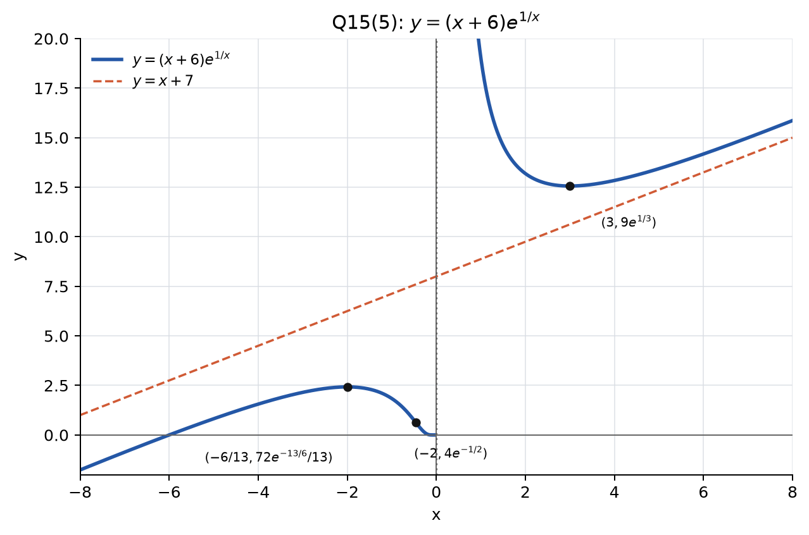
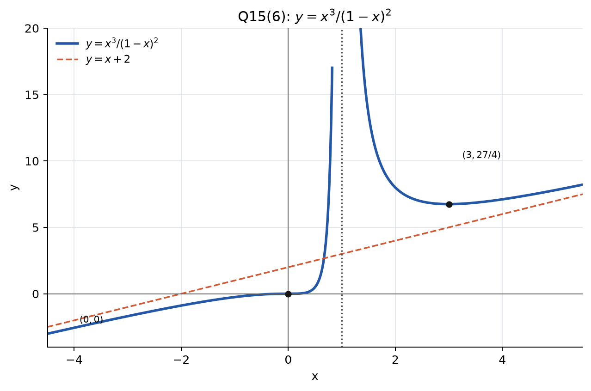

# 第八次作业参考答案

> 题号按《微积分 I（第四版）》习题 2.4 标注．

## 1(4)

函数

$$
y=\left(1+\frac1x\right)^x,\qquad x>0
$$

满足

$$
y'=\left(1+\frac1x\right)^x
\left[\ln\left(1+\frac1x\right)-\frac1{x+1}\right].
$$

令 \(t=\dfrac1x>0\)，并记

$$
g(t)=\ln(1+t)-\frac{t}{1+t}.
$$

则

$$
g'(t)=\frac1{1+t}-\frac1{(1+t)^2}
=\frac{t}{(1+t)^2}>0,
$$

且 \(g(0)=0\)，所以 \(g(t)>0\ (t>0)\)．因此 \(y'>0\)，函数在 \((0,+\infty)\) 上单调增加．

## 2

对

$$
F(x)=\frac{f(x)-f(a)}{x-a}\qquad(x>a)
$$

求导，得

$$
F'(x)=
\frac{f'(x)(x-a)-[f(x)-f(a)]}{(x-a)^2}.
$$

由拉格朗日中值定理，存在 \(\xi\in(a,x)\)，使得

$$
f(x)-f(a)=f'(\xi)(x-a).
$$

又因为 \(f''(x)>0\)，所以 \(f'\) 在 \((a,+\infty)\) 上严格单调增加．由 \(\xi<x\)，得 \(f'(\xi)<f'(x)\)．于是

$$
f'(x)(x-a)-[f(x)-f(a)]
=[f'(x)-f'(\xi)](x-a)>0.
$$

故 \(F'(x)>0\)，即 \(F(x)\) 在 \((a,+\infty)\) 内单调增加．

## 3(2)

先证右侧不等式．令

$$
g(x)=x-\arctan x,\qquad x>0.
$$

则

$$
g'(x)=1-\frac1{1+x^2}=\frac{x^2}{1+x^2}>0,
$$

且 \(g(0)=0\)，故 \(\arctan x<x\)．

再令

$$
h(x)=\arctan x-x+\frac{x^3}{3}.
$$

则

$$
h'(x)=\frac1{1+x^2}-1+x^2=\frac{x^4}{1+x^2}>0,
$$

且 \(h(0)=0\)，故

$$
x-\frac{x^3}{3}<\arctan x.
$$

合并两端即得所证不等式．

## 3(5)

令

$$
f(x)=1+x\ln\left(x+\sqrt{1+x^2}\right)-\sqrt{1+x^2},
\qquad x>0.
$$

因为

$$
\frac{\mathrm d}{\mathrm dx}\ln\left(x+\sqrt{1+x^2}\right)
=\frac1{\sqrt{1+x^2}},
$$

所以

$$
f'(x)
=\ln\left(x+\sqrt{1+x^2}\right)
+\frac{x}{\sqrt{1+x^2}}
-\frac{x}{\sqrt{1+x^2}}
=\ln\left(x+\sqrt{1+x^2}\right)>0.
$$

又 \(f(0)=0\)，于是当 \(x>0\) 时 \(f(x)>0\)，即

$$
1+x\ln\left(x+\sqrt{1+x^2}\right)>\sqrt{1+x^2}.
$$

## 4(5)

函数 \(y=x^2\mathrm e^{-x^2}\) 的定义域为 \(\mathbb R\)，且

$$
y'=2x(1-x^2)\mathrm e^{-x^2}.
$$

驻点为 \(x=-1,0,1\)．导数在区间

$$
(-\infty,-1),\quad(-1,0),\quad(0,1),\quad(1,+\infty)
$$

上的符号依次为 \(+,-,+,-\)．

因此 \(x=\pm1\) 处取得极大值，\(x=0\) 处取得极小值：

$$
y_{\max}=y(\pm1)=\frac1{\mathrm e},\qquad y_{\min}=y(0)=0.
$$

## 4(6)

令 \(t=\cos x\in[-1,1]\)，则

$$
y=\sin^2x-\cos x=1-t^2-t
=\frac54-\left(t+\frac12\right)^2.
$$

当 \(t=\dfrac12\) 时取得最小值 \(-1\)，对应

$$
x=2k\pi\qquad(k\in\mathbb Z).
$$

当 \(t=-\dfrac12\) 时取得最大值 \(\dfrac54\)，对应

$$
x=\frac{2\pi}{3}+2k\pi
\quad\text{或}\quad
x=\frac{4\pi}{3}+2k\pi\qquad(k\in\mathbb Z).
$$

所以最小值为 \(-1\)，最大值为 \(\dfrac54\)．

## 6(5)

因为

$$
x^2-3x+2=(x-1)(x-2),
$$

所以当 \(0\le x\le1\) 时，

$$
y=x^2-3x+2-x=x^2-4x+2,
$$

它在 \([0,1]\) 上单调减少．当 \(1\le x\le2\) 时，

$$
y=-(x^2-3x+2)-x=-x^2+2x-2,
$$

它在 \([1,2]\) 上也单调减少．

于是最大值在 \(x=0\) 处取得：

$$
y_{\max}=2.
$$

最小值在 \(x=2\) 处取得：

$$
y_{\min}=-2.
$$

## 10

设矩形断面的宽为 \(x\)，高为 \(y\)．矩形内接于直径为 \(d\) 的圆，故

$$
x^2+y^2=d^2.
$$

梁的强度满足

$$
S=kxy^2=kx(d^2-x^2),\qquad 0<x<d,\ k>0.
$$

于是

$$
S'(x)=k(d^2-3x^2).
$$

唯一的区间内部驻点为

$$
x=\frac d{\sqrt3}.
$$

此时

$$
y=\sqrt{d^2-x^2}
=d\sqrt{\frac23},
$$

并且 \(S''(x)=-6kx<0\)，所以该点使强度最大．高与宽之比为

$$
\frac yx=\sqrt2.
$$

## 12(3)

函数的定义域为 \(\mathbb R\)．

$$
y'=\frac{\mathrm e^{\arctan x}}{1+x^2},
$$

$$
y''
=\mathrm e^{\arctan x}
\left[
\frac1{(1+x^2)^2}
-\frac{2x}{(1+x^2)^2}
\right]
=\frac{(1-2x)\mathrm e^{\arctan x}}{(1+x^2)^2}.
$$

当 \(x<\dfrac12\) 时 \(y''>0\)，曲线为凹；当 \(x>\dfrac12\) 时 \(y''<0\)，曲线为凸．

拐点为

$$
\left(\frac12,\mathrm e^{\arctan(1/2)}\right).
$$

## 12(4)

函数 \(y=\dfrac ax\ln\dfrac xa\) 的定义域为 \(x>0\)．

$$
y'=\frac a{x^2}\left(1-\ln\frac xa\right),
$$

$$
y''=\frac a{x^3}\left(2\ln\frac xa-3\right).
$$

因为 \(a>0\)，所以：

$$
\begin{cases}
y''<0,&0<x<a\mathrm e^{3/2},\\
y''>0,&x>a\mathrm e^{3/2}.
\end{cases}
$$

因此曲线在 \(\left(0,a\mathrm e^{3/2}\right)\) 上为凸，在 \(\left(a\mathrm e^{3/2},+\infty\right)\) 上为凹．

拐点为

$$
\left(a\mathrm e^{3/2},\frac{3}{2\mathrm e^{3/2}}\right).
$$

## 14(3)

函数的定义域为 \(x>0\)．

当 \(x\to0^+\) 时，

$$
\frac{\ln x}{x}\to-\infty,
$$

所以直线 \(x=0\) 是竖直渐近线．

又

$$
k=\lim_{x\to+\infty}\frac yx
=\lim_{x\to+\infty}\left(1+\frac{\ln x}{x^2}\right)=1,
$$

$$
b=\lim_{x\to+\infty}(y-x)
=\lim_{x\to+\infty}\frac{\ln x}{x}=0.
$$

因此直线

$$
y=x
$$

是斜渐近线．

## 14(6)

函数的定义域为 \(x\ne0\)．记

$$
A(x)=\exp\left(\frac{\pi}{2}+\arctan(x^2)\right).
$$

当 \(x\to0\) 时，

$$
A(x)\to\mathrm e^{\pi/2},
$$

而 \(\left(x-\dfrac1x\right)A(x)\sim-\dfrac1x\)，故

$$
\lim_{x\to0^+}y=-\infty,\qquad
\lim_{x\to0^-}y=+\infty.
$$

因此直线 \(x=0\) 是竖直渐近线．

当 \(x\to+\infty\) 或 \(x\to-\infty\) 时，利用

$$
\arctan(x^2)=\frac{\pi}{2}-\frac1{x^2}+O(x^{-6}),
$$

可得

$$
A(x)=\mathrm e^\pi\left(1-\frac1{x^2}+O(x^{-4})\right).
$$

于是

$$
y-\mathrm e^\pi x
=\left(x-\frac1x\right)A(x)-\mathrm e^\pi x
=x[A(x)-\mathrm e^\pi]-\frac{A(x)}x\to0.
$$

因此直线

$$
y=\mathrm e^\pi x
$$

是斜渐近线．

## 15(5)

函数

$$
y=(x+6)\mathrm e^{1/x}
$$

的定义域为 \(x\ne0\)．

一阶导数为

$$
y'=\mathrm e^{1/x}
\left(1-\frac{x+6}{x^2}\right)
=\frac{(x-3)(x+2)}{x^2}\mathrm e^{1/x}.
$$

当 \(x<-2\) 或 \(x>3\) 时 \(y'>0\)；当 \(-2<x<0\) 或 \(0<x<3\) 时 \(y'<0\)．所以函数在 \((-\infty,-2)\) 和 \((3,+\infty)\) 上单调增加，在 \((-2,0)\) 和 \((0,3)\) 上单调减少．

极大值为

$$
y(-2)=4\mathrm e^{-1/2},
$$

极小值为

$$
y(3)=9\mathrm e^{1/3}.
$$

二阶导数为

$$
y''=\frac{(13x+6)\mathrm e^{1/x}}{x^4}.
$$

当 \(x<-\dfrac6{13}\) 时 \(y''<0\)；当 \(-\dfrac6{13}<x<0\) 或 \(x>0\) 时 \(y''>0\)．曲线在 \((-\infty,-6/13)\) 上为凸，在 \((-6/13,0)\) 和 \((0,+\infty)\) 上为凹．拐点为

$$
\left(-\frac6{13},\frac{72}{13}\mathrm e^{-13/6}\right).
$$

当 \(x\to+\infty\) 或 \(x\to-\infty\) 时，

$$
y-(x+7)\to0,
$$

所以 \(y=x+7\) 是斜渐近线．又

$$
\lim_{x\to0^-}y=0,\qquad
\lim_{x\to0^+}y=+\infty,
$$

所以 \(x=0\) 是竖直渐近线．

## 15(6)

函数

$$
y=\frac{x^3}{(1-x)^2}
$$

的定义域为 \(x\ne1\)．一阶、二阶导数分别为

$$
y'=\frac{x^2(x-3)}{(x-1)^3},
\qquad
y''=\frac{6x}{(x-1)^4}.
$$

当 \(x<1\) 且 \(x\ne0\)，或 \(x>3\) 时 \(y'>0\)；当 \(1<x<3\) 时 \(y'<0\)．因此函数在 \((-\infty,0)\)、\((0,1)\) 和 \((3,+\infty)\) 上单调增加，在 \((1,3)\) 上单调减少．

极小值为

$$
y(3)=\frac{27}{4}.
$$

当 \(x<0\) 时 \(y''<0\)，当 \(x>0\) 且 \(x\ne1\) 时 \(y''>0\)．曲线在 \((-\infty,0)\) 上为凸，在 \((0,1)\) 和 \((1,+\infty)\) 上为凹．点 \((0,0)\) 是拐点．

直线 \(x=1\) 是竖直渐近线．又

$$
y=x+2+\frac{3x-2}{(x-1)^2},
$$

且

$$
\lim_{x\to\pm\infty}\frac{3x-2}{(x-1)^2}=0,
$$

所以 \(y=x+2\) 是斜渐近线．

---

## 评分参考

整卷满分 100 分．各题分值为：1(4) 5 分，2 题 8 分，3(2) 6 分，3(5) 6 分，4(5) 5 分，4(6) 7 分，6(5) 8 分，10 题 8 分，12(3) 6 分，12(4) 8 分，14(3) 6 分，14(6) 10 分，15(5) 8 分，15(6) 9 分．只写结果不写过程，该题最多给一半；等价方法只要推理完整，同样算对．
